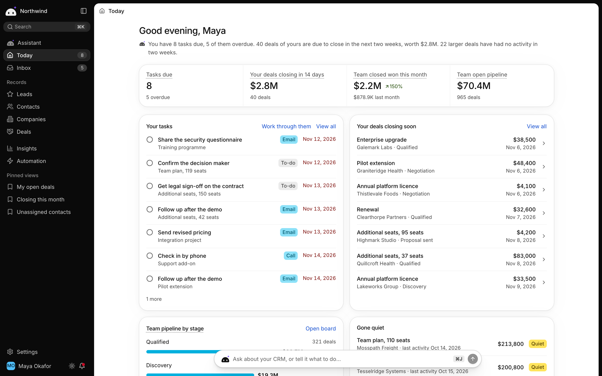
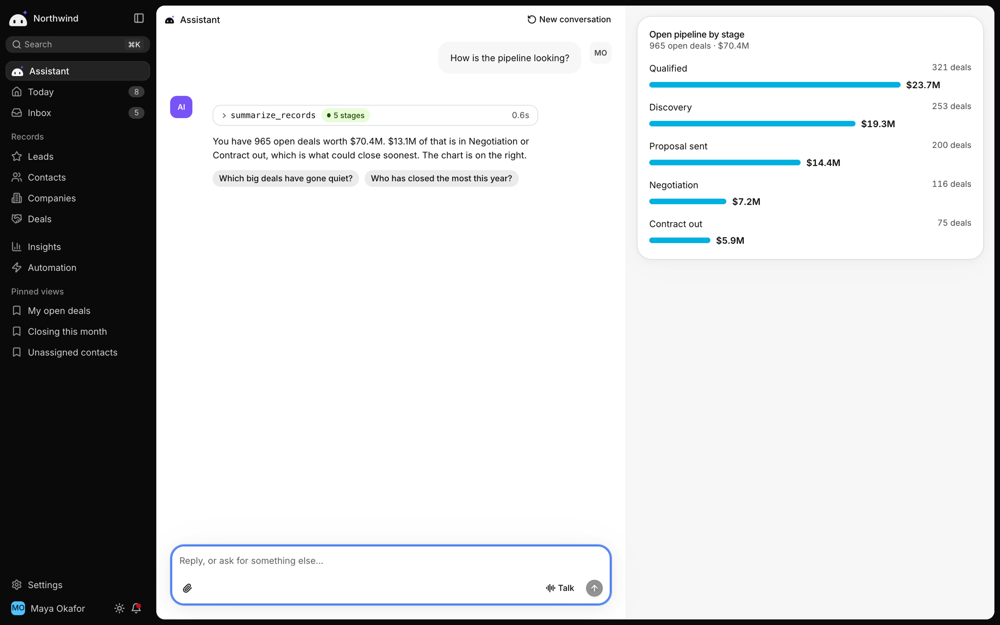
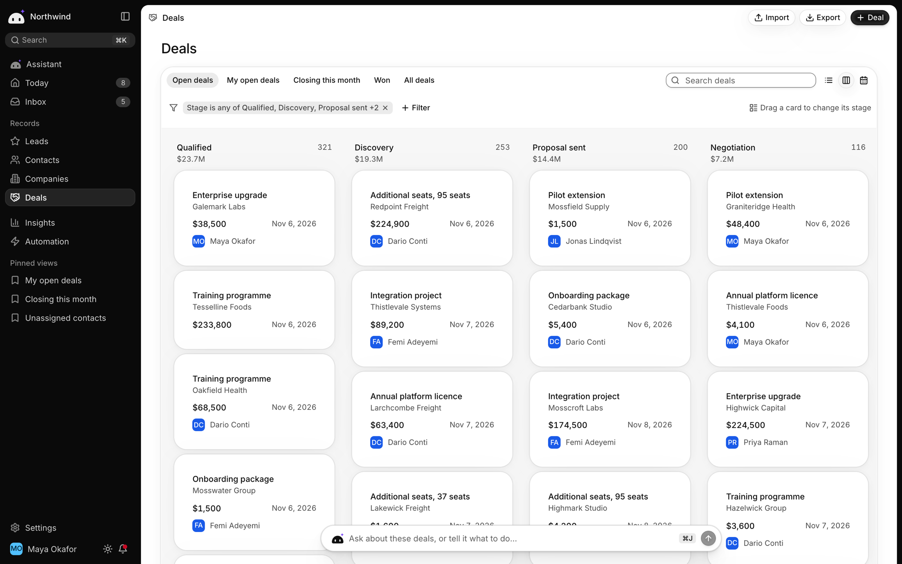
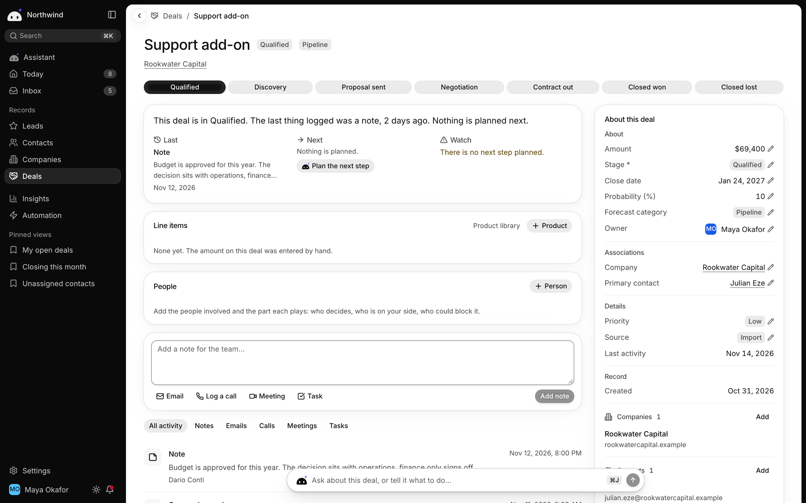
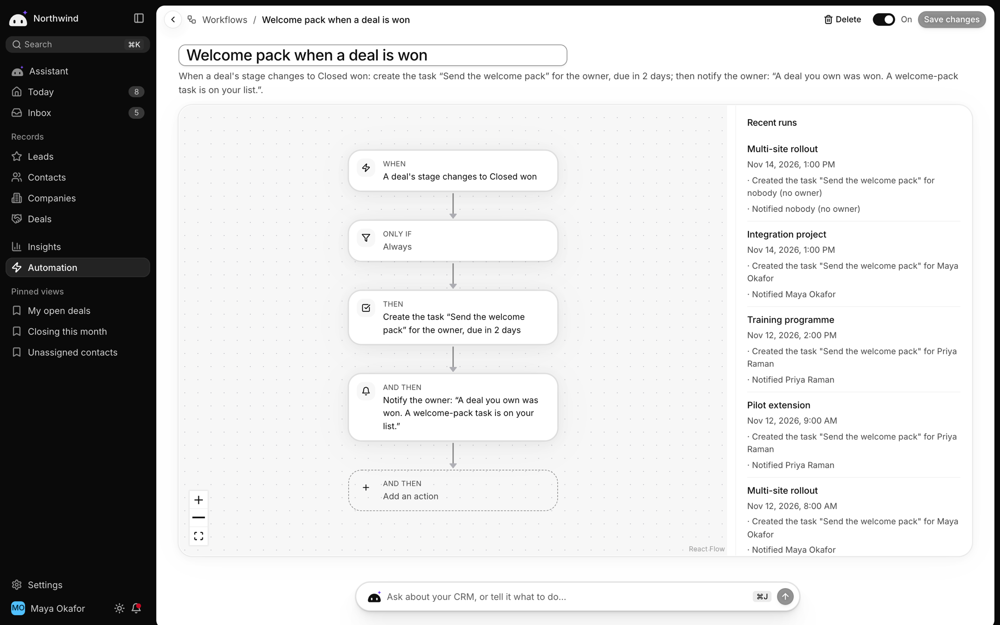
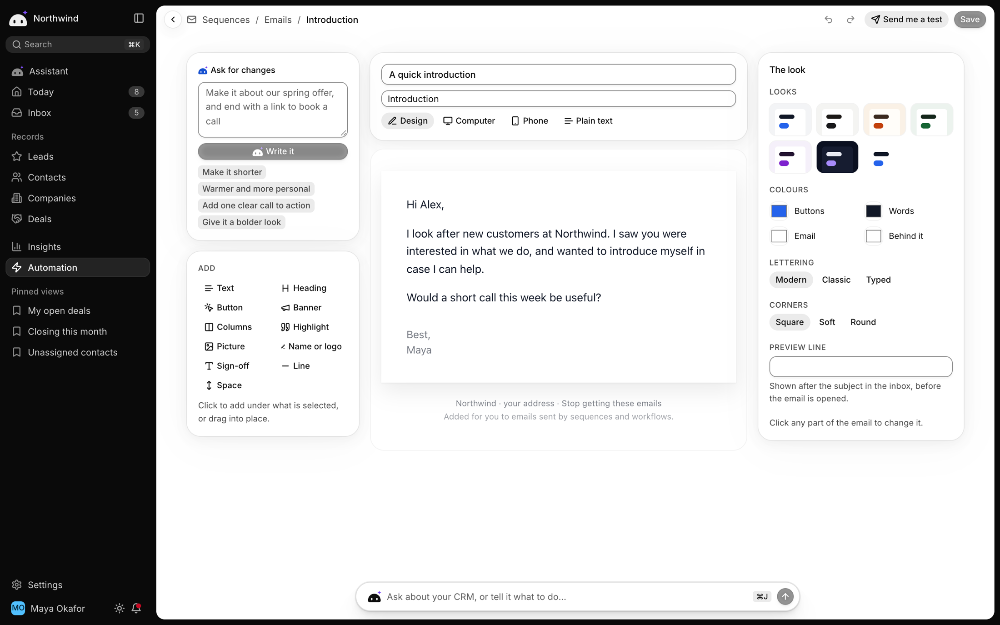
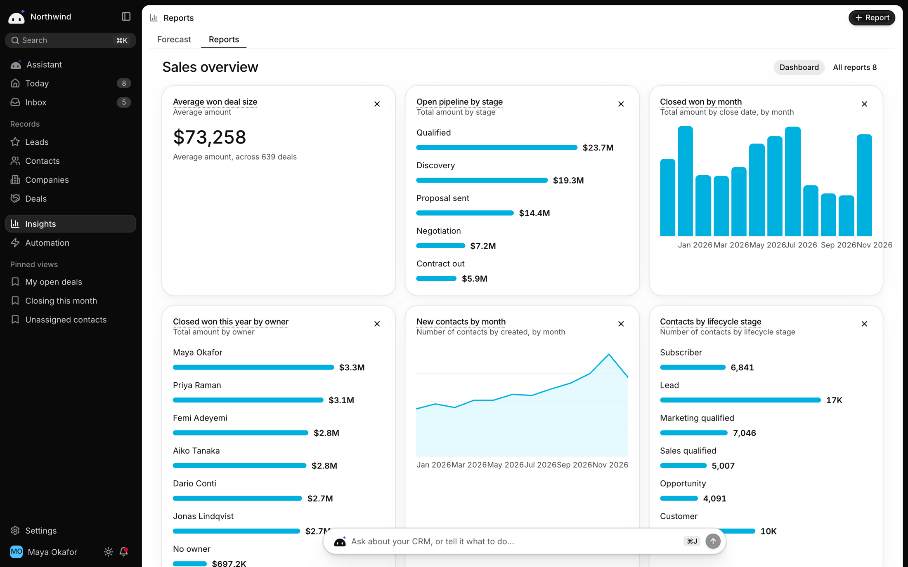
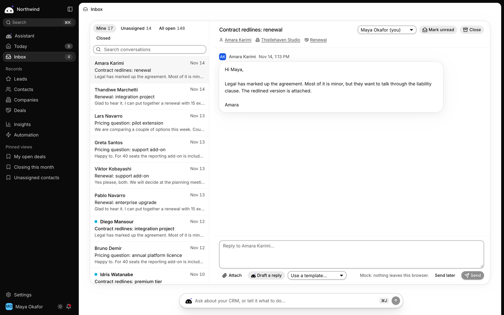

<div align="center">

<picture>
  <source media="(prefers-color-scheme: dark)" srcset="docs/assets/mark-dark.svg">
  
</picture>

# Ensemble CRM

**A complete CRM you run as your own instance and change by asking.**

It does what teams use HubSpot for, it is built so the assistant does most of the data entry,<br>
and every part of it can be reached by an agent as easily as by a person.

[What it does](#what-it-does) · [A look around](#a-look-around) · [Built for agents](#built-for-agents) · [Moving in from HubSpot](#moving-in-from-hubspot) · [Run it](#run-it) · [Status](#status)

<br>

<picture>
  <source media="(prefers-color-scheme: dark)" srcset="docs/screenshots/today-dark.png">
  
</picture>

</div>

<br>

## What it is

Ensemble CRM is the first template for [Ensemble](docs/PLAN.md), a hosted platform where a team takes a working product, runs it as their own instance, and reshapes it without writing code.

Three ideas run through it:

- **One instance per team.** Your data is in your own database, not a row in someone else's.
- **Everything is data.** Objects, fields, views, pipelines, forms, workflows, reports and email designs are definitions, not code. Adding a custom object or a field needs no new screen and no migration.
- **One list of operations.** The app, the HTTP API, the MCP server and the assistant's tools are all generated from the same list, so anything a person can do, an agent can do, with the same permissions and the same audit trail.

## What it does

| | |
|---|---|
| **Records** | Contacts, companies, deals, leads, tasks and products. Custom objects and fields. Saved views, filters, search, bulk edit, CSV import and export. Required, unique and conditional fields. Formulas and scores. Duplicate detection and merging. Deleted records can be restored. |
| **Selling** | A pipeline board with stage rules. Line items from a product library. The people on a deal and the part each plays. Lead conversion. A forecast with goals. |
| **Email** | A shared inbox linked to contacts, companies and deals. Saved emails, scheduled sends and attachments. An email designer that builds from blocks. Unsubscribes, bounces, sending limits and delivery reports. |
| **Sequences** | Steps of emails, calls and tasks with waits between them. Enrolment from any list. Stops when someone replies. |
| **Automation** | A workflow builder: when this happens, if these conditions hold, do these things. Triggers on record changes, on a schedule, or from another system calling in. |
| **Capture** | Forms with hosted pages and spam traps. Booking pages with time zones, round robin and group meetings. |
| **Reporting** | A report builder, dashboards, and reports emailed on a schedule. |
| **Team** | Roles that set how far each person can see and change. Teams. An audit log of every change, who or what made it, and how. Privacy export and erase. |
| **The assistant** | Asks and answers in plain words, on any model you connect. It plans changes and waits for approval before making them. It drafts emails, sequences, workflows, forms and reports, and can fill in fields you describe. |

## A look around

<table>
<tr>
<td width="50%" valign="top">

**Ask instead of clicking**



The assistant reads your records through the same operations everything else uses, shows its work beside the conversation, and asks before it changes anything.

</td>
<td width="50%" valign="top">

**A pipeline you can move**



Drag a deal to change its stage. Each stage can require fields, and a deal can be held to moving one stage at a time.

</td>
</tr>
<tr>
<td width="50%" valign="top">

**Every record says where it stands**



What happened last, what is planned next and what to watch, above the fields and the full history.

</td>
<td width="50%" valign="top">

**Workflows you can read**



Each workflow is written out as a sentence and drawn as steps, with what every recent run did.

</td>
</tr>
<tr>
<td width="50%" valign="top">

**Email, designed by describing it**



An email is a look and a stack of blocks. Build it by hand, or say what you want and let the model write it.

</td>
<td width="50%" valign="top">

**Reports without a spreadsheet**



Count or total anything by any field, pin charts to a dashboard, and have them emailed on a schedule.

</td>
</tr>
</table>

<details>
<summary><b>One more: the shared inbox</b></summary>
<br>

</details>

## Built for agents

Every operation is described once, in [`src/contracts/operations.ts`](src/contracts/operations.ts): its name, what it does in words, the shape of what it takes and returns, and whether it reads, writes, sends or destroys. From that one list:

- **HTTP:** `POST /api/ops/<name>` with `{ "input": … }`.
- **MCP:** `POST /api/mcp`. Every operation is a tool, with its description and schema.
- **The assistant:** the same operations are its tools, run as the person asking.
- **The app:** the web client is built from the list too.

An agent is a member like any other. It signs in with a key, has a role, can be limited to reading or writing, and everything it does lands in the audit log under its own name.

## Moving in from HubSpot

A move is a list of steps you can see. Each step reads one kind of thing a page at a time and keeps its own progress, so a move can be **checked before anything is written**, paused, resumed after a restart, and **run again without making anything twice**.

- **The standard plan needs no model:** people, pipelines and stages, custom fields with their choices, companies, contacts, deals, tasks, custom objects, and notes, calls, emails and meetings as history.
- **Unsubscribes and bounces come across in the same write as the contact**, and that step cannot be skipped.
- **On top of it, a connected model can look at what else the account uses** and put forward what to bring, what to set up here, and what would need building. Nothing it proposes happens until someone accepts it.

> [!NOTE]
> The importer has been tested against a stand-in account built from HubSpot's API documentation. It has not yet been run against a real HubSpot account.

## Run it

**The demo, with no backend.** Everything runs in the browser on generated data.

```bash
pnpm install
```

```bash
pnpm dev
```

Open http://localhost:5183.

> [!IMPORTANT]
> Until the next [Mariachi](https://github.com/mariachi-ai/ts) release, the `@mariachi/*` packages are linked from a checkout beside this repository (`../../mariachi`). `pnpm install` will not work without it.

**The whole thing**, with the server, the worker, Postgres and Redis. You need Docker.

```bash
cp server/.env.example server/.env
```

```bash
pnpm db:up
```

```bash
pnpm db:seed
```

Then, each in its own terminal:

```bash
pnpm api
```

```bash
pnpm worker
```

```bash
pnpm dev:live
```

Open http://localhost:5185. You are signed in as the demo admin. To use the assistant on a real model, connect one in Settings with your own key.

**Tests**

```bash
pnpm test
```

The server tests run the real services against a real Postgres database (`pnpm db:up` first).

## How it is put together

```
src/
  contracts/   The shapes everything agrees on, and the one list of operations
  pages/       Screens, all rendered from definitions
  assistant/   The assistant's bar, thread and canvas
  lib/         Rules shared by browser and server: formulas, scores, email rendering, time zones
  mock/        The in-browser demo: the same API, on generated data
server/
  src/services/    One folder per area: records, inbox, workflows, sequences, migration, …
  src/assistant/   The assistant on a connected model
  src/schema/      Tables
  test/            Tests that call operations the way the API and MCP do
docs/
  PLAN.md          What is being built and why
  EQUIVALENCE.md   HubSpot, job by job, and what this does instead
  TODO.md          Everything outstanding, in the order it will be done
```

The frontend is React, TypeScript and Vite. The backend is built on [Mariachi](https://github.com/mariachi-ai/ts) and its design library. Email, sign-in, file storage and the model are each behind an interface, so the provider can be swapped.

## Status

This is pre-release software. It works end to end in development and is not yet ready to hold a team's real data.

What stands between here and a first release, in short:

- Sign-in and email through Ensemble. Today there are development stand-ins for both.
- The importer proven on a real HubSpot account.
- Gmail and Outlook sync, which comes straight after.

The full list, and the order it will be done in, is in [docs/TODO.md](docs/TODO.md).

## Licence

Not yet chosen. Until a licence is added, the code is published for reading and is not licensed for reuse.
